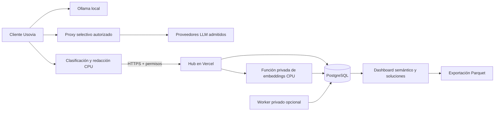

# Usovia · Gobierno corporativo de IA

[](https://github.com/vtomasv/usovia/actions/workflows/ci.yml)

Usovia conecta el aprendizaje cotidiano de los colaboradores con recomendaciones y oportunidades para su organización. Incluye un cliente de escritorio con IA local y un Hub corporativo. La participación es voluntaria y los permisos se autorizan por separado.

[Visitar Usovia](https://usovia-hub-demo.vercel.app) · [Presentar la central 1.2](docs/product-demo.md) · [Cliente macOS](docs/version-1.1.md) · [Cliente Windows e instaladores](docs/windows.md) · [CI y publicación manual](docs/deployment.md)

## Qué incluye

- Landing para colaboradores: recorrido educativo, permisos, instalación y oportunidades de aprendizaje; sugiere el paquete Mac o Windows mediante detección local del sistema y permite elegirlo manualmente.
- Cliente Electron para macOS Apple Silicon y Windows x64, con motor Ollama incluido, icono en barra de menús/bandeja y ventana que puede cerrarse sin finalizar la aplicación. El paquete Windows usa CPU; la edición 1.3 añade integración autorizada con navegadores que usan proxy y confianza TLS del sistema.
- Captura autorizada de solicitudes y, con permiso adicional, respuestas; texto redactado y recomendaciones mediante reglas ligeras en CPU.
- Proxy TLS selectivo para proveedores del catálogo admitido. La central configura proveedores y rutas de generación; no habilita la captura del participante remotamente.
- Dashboard de inteligencia de uso: categorías, procesos recurrentes, cobertura de captura y resultados con evidencia.
- Mapa semántico real con embeddings multilingües: executor CPU protegido en Vercel o worker en infraestructura privada, sin APIs externas de inferencia.
- Biblioteca de prompts/respuestas con aceptación explícita y validación humana versionada; una respuesta HTTP 200 no significa éxito.
- Directorio con búsqueda paginada por cuenta seudónima y grupos; conversaciones completas por departamento, sucursal y etiqueta.
- Exportación Parquet real de turnos, sesiones y soluciones, con texto opcional, esquema y archivos partidos.
- Cuentas con ID de activación de un solo uso, permisos revocables, estado con fecha y eliminación de aportes.
- API Node en Vercel y persistencia PostgreSQL; almacenamiento JSON local para desarrollo.

## Cobertura y límites

La captura cubre chat/API local, Gemini en el navegador integrado y API/CLI configuradas con el proxy. Los navegadores del sistema requieren su autorización y compatibilidad con el PAC y la CA del equipo. ChatGPT y Claude web todavía necesitan adaptadores validados. No se promete cobertura universal ni captura de archivos, audio e imágenes.

El modo actual observa sin bloqueo de contenido. Se redactan patrones conocidos; esto no garantiza anonimización. Las cuentas no piden nombre/correo, pero el contexto puede permitir identificar a una persona. Las oportunidades son hipótesis para revisión humana y no miden productividad. Un reporte reciente no demuestra el estado de encendido del computador.

El instalador 1.1 no tiene firma Developer ID ni notarización. La nueva autorización gráfica de la integración de navegadores requiere revalidación completa; el ayudante utiliza una API macOS heredada que debe sustituirse antes de distribución gestionada. Revisa [los límites técnicos](docs/version-1.1.md) y [seguridad](SECURITY.md).

## Arquitectura



El motor Ollama es un componente independiente; Usovia no es un fork de Ollama y no incorpora Plano en producción. La ingesta conserva una fila JSONB por tenant con bloqueo transaccional; las lecturas son independientes y los derivados analíticos utilizan tablas relacionales de cola, vectores, revisiones y exportaciones. Sigue siendo una arquitectura para instalaciones pequeñas, pendiente de normalizar la ingesta y reforzar el aislamiento. El historial mantiene siete días y hasta 500 turnos por espacio. La consola utiliza una sesión administrativa; SSO/RBAC granular son pendientes.

## Desarrollo local

Node 22 y npm:

```sh
npm ci
npm run dev
```

Frontend: `http://127.0.0.1:5173`. API: `http://127.0.0.1:4310`. El script crea secretos locales si faltan. Consulta la contraseña en `.env.local` y no publiques ese archivo. Para PostgreSQL, configura `DATABASE_URL` y ejecuta `npm run db:init`. `.env.example` contiene solo nombres y configuración sin credenciales.

```sh
npm run check
npm test
npm run build
```

En Linux, se omiten explícitamente dos pruebas que requieren el servicio y el ayudante nativos de macOS; las demás validan lógica, API, permisos, sesiones y proxy TLS. En macOS, compílalo antes de las pruebas con `npm run build:browser-helper --workspace @usovia/desktop`.

Para infraestructura propia, el worker se instala y opera por separado dentro del entorno privado de la empresa. Consulta [arquitectura, calidad, operación y esquema Parquet](docs/analytics.md) y [su configuración](analytics-worker/README.md). La central 1.2 está publicada en el demo de Vercel; el repositorio no cambia automáticamente el despliegue público. Las sesiones de demostración están etiquetadas y usan respuestas de un modelo local. La demo procesa nuevas sesiones mediante una función CPU protegida de Vercel; también admite un worker en infraestructura privada.

## Cliente de escritorio

Para empaquetar macOS se requiere arm64 y Xcode Command Line Tools. Windows se compila y verifica en un runner nativo, y se publica en GitHub Releases con hashes y evidencia de instalación/inferencia; consulta [el pipeline y sus límites](docs/windows.md). El runtime y los modelos no están en Git. Prepara el motor desde una instalación oficial conservando avisos y licencias:

```sh
node scripts/bundle-runtime.mjs '/Applications/Ollama.app/Contents/Resources'
npm run build:browser-helper --workspace @usovia/desktop
npm run desktop:dev
npm run desktop:package
```

Los artefactos se generan en `desktop/release/`. Los pesos se descargan por separado y tienen licencias propias. No copies configuración, modelos ni credenciales personales de otra instalación.

## Pipeline

GitHub Actions verifica automáticamente formato, Node 22, tipos, pruebas, dependencias de producción y build. El despliegue de Vercel es manual: el proyecto no está conectado a GitHub y los despliegues Git están desactivados explícitamente en `vercel.json`. Un push valida el código; no publica la web.

El repositorio está en [vtomasv/usovia](https://github.com/vtomasv/usovia). Los commits se atribuyen a `vtomasv <vtomasv@gmail.com>`. Para publicar, revisa el CI y ejecuta `npm run deploy` en una máquina autenticada y vinculada al proyecto Vercel correcto. La configuración privada de CLI y los instaladores no están en Git. Consulta [publicación manual y rollback](docs/deployment.md).

## Organización del frontend

- `src/main.tsx`: entrada de React; `src/app.tsx`: coordinación de sesión y consola.
- `src/landing.tsx`: experiencia del colaborador.
- `src/api.ts`: cliente HTTP tipado, manejo de errores y cancelación.
- `src/types.ts` y `src/format.ts`: contratos de la consola y formatos compartidos.
- `src/analytics.tsx`, `src/analytics-dialogs.tsx` y `src/components/account-directory.tsx`: inteligencia de uso, revisión/exportación y búsqueda empresarial.
- `src/providers.tsx` y `src/conversations.tsx`: vistas por responsabilidad, cargadas solo al abrirlas.
- `src/components/`: marca, acceso administrativo y tabla de aportes.

`npm run format` mantiene el formato del frontend; `npm run format:check` lo valida sin modificar archivos.

## Código y componentes de terceros

Repositorio público para inspección y colaboración. No se ha concedido todavía una licencia general de redistribución del código propio de Usovia; publicación pública y licencia de software son decisiones distintas. Los componentes de terceros conservan sus licencias. El aviso de Ollama se encuentra en [licenses/Ollama-LICENSE](licenses/Ollama-LICENSE); los manifiestos del runtime documentan sus componentes al empaquetar.
