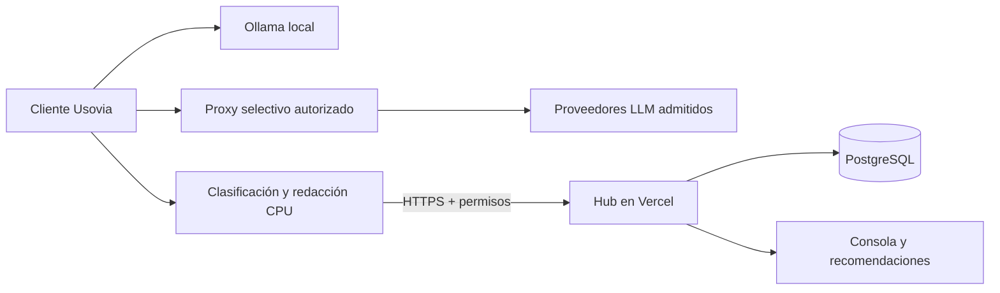

# Usovia · Gobierno corporativo de IA

Usovia conecta el aprendizaje cotidiano de los colaboradores con recomendaciones y oportunidades para su organización. Incluye un cliente de escritorio con IA local y un Hub corporativo. La participación es voluntaria y los permisos se autorizan por separado.

[Visitar Usovia](https://usovia-hub-demo.vercel.app) · [Alcance de la versión 1.1](docs/version-1.1.md) · [Despliegue automatizado](docs/deployment.md)

## Qué incluye

- Landing para colaboradores: recorrido educativo, permisos, instalación y oportunidades de aprendizaje.
- Cliente Electron para macOS Apple Silicon, motor Ollama incluido, icono en barra de menús y ventana que puede cerrarse sin finalizar la aplicación.
- Captura autorizada de solicitudes y, con permiso adicional, respuestas; texto redactado y recomendaciones mediante reglas ligeras en CPU.
- Proxy TLS selectivo para proveedores del catálogo admitido. La central configura proveedores y rutas de generación; no habilita la captura del participante remotamente.
- Consola con conversaciones ordenadas, filtros y agrupaciones por cuenta seudónima, departamento, sucursal y etiqueta.
- Cuentas con ID de activación de un solo uso, permisos revocables, estado con fecha y eliminación de aportes.
- API Node en Vercel y persistencia PostgreSQL; almacenamiento JSON local para desarrollo.

## Cobertura y límites

La captura cubre chat/API local, Gemini en el navegador integrado y API/CLI configuradas con el proxy. Los navegadores del sistema requieren su autorización y compatibilidad con el PAC y la CA del equipo. ChatGPT y Claude web todavía necesitan adaptadores validados. No se promete cobertura universal ni captura de archivos, audio e imágenes.

El modo actual observa sin bloqueo de contenido. Se redactan patrones conocidos; esto no garantiza anonimización. Las cuentas no piden nombre/correo, pero el contexto puede permitir identificar a una persona. Las oportunidades son hipótesis para revisión humana y no miden productividad. Un reporte reciente no demuestra el estado de encendido del computador.

El instalador 1.1 no tiene firma Developer ID ni notarización. La nueva autorización gráfica de la integración de navegadores requiere revalidación completa; el ayudante utiliza una API macOS heredada que debe sustituirse antes de distribución gestionada. Revisa [los límites técnicos](docs/version-1.1.md) y [seguridad](SECURITY.md).

## Arquitectura



El motor Ollama es un componente independiente; Usovia no es un fork de Ollama y no incorpora Plano en producción. La base de datos actual utiliza una fila JSONB por tenant con bloqueo transaccional: es una arquitectura para instalaciones pequeñas, pendiente de normalización y aislamiento de mayor escala. La consola utiliza una sesión administrativa; SSO/RBAC granular son pendientes.

## Desarrollo local

Node 22 y npm:

```sh
npm ci
npm run dev
```

Frontend: `http://127.0.0.1:5173`. API: `http://127.0.0.1:4310`. El script crea secretos locales si faltan. Consulta la contraseña en `.env.local` y no publiques ese archivo. Para PostgreSQL, configura `DATABASE_URL` y ejecuta `npm run db:init`. `.env.example` contiene solo nombres y configuración sin credenciales.

```sh
npm run check
npm test
npm run build
```

En Linux, las pruebas no ejecutan el ayudante nativo de macOS. En macOS, compílalo antes de las pruebas con `npm run build:browser-helper --workspace @usovia/desktop`.

## Cliente de escritorio

Requiere macOS arm64 y Xcode Command Line Tools. El runtime y los modelos no están en Git. Prepara el motor desde una instalación oficial conservando avisos y licencias:

```sh
node scripts/bundle-runtime.mjs '/Applications/Ollama.app/Contents/Resources'
npm run build:browser-helper --workspace @usovia/desktop
npm run desktop:dev
npm run desktop:package
```

Los artefactos se generan en `desktop/release/`. Los pesos se descargan por separado y tienen licencias propias. No copies configuración, modelos ni credenciales personales de otra instalación.

## Pipeline

GitHub Actions verifica Node 22, tipos, pruebas, dependencias de producción y build. Vercel conectado al repositorio publica `main` y ejecuta tipos/pruebas en su propio build. Los instaladores se publican por separado; no se comparten tokens de Vercel con Actions. Consulta [configuración, identidad y rollback](docs/deployment.md).

## Código y componentes de terceros

Repositorio público para inspección y colaboración. No se ha concedido todavía una licencia general de redistribución del código propio de Usovia; publicación pública y licencia de software son decisiones distintas. Los componentes de terceros conservan sus licencias. El aviso de Ollama se encuentra en [licenses/Ollama-LICENSE](licenses/Ollama-LICENSE); los manifiestos del runtime documentan sus componentes al empaquetar.
