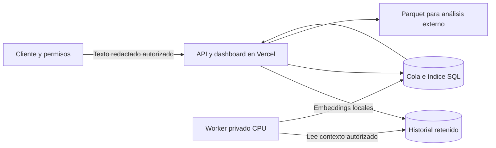

# Análisis corporativo de usos de IA

La central incorpora una vista de inteligencia de uso, un mapa semántico y una biblioteca de soluciones revisables. Se calculan a partir del historial realmente recibido con consentimiento; no se insertan ejemplos ficticios en producción. La nueva funcionalidad requiere publicar el Hub y ejecutar un worker privado para obtener vínculos semánticos. Un push valida el código, sin desplegar Vercel.

## Qué puede explicar la consola

Los filtros de cuenta, departamento, sucursal, etiqueta, categoría, resultado, fechas y contenido se aplican en el servidor. Las fechas son días UTC de recepción; seleccionan sesiones con actividad en el rango, mientras la evaluación conserva todo su contexto disponible. La gráfica diaria muestra solo los turnos del rango. Los conteos de contexto pueden ser mayores. El directorio busca por términos sin distinguir acentos, muestra 20 resultados por página y admite hasta 1.000 cuentas en esta instalación.

La clasificación de trabajo utiliza una taxonomía bilingüe de reglas CPU: software, datos, comunicación, atención, planificación, investigación, marketing, finanzas, personas, contratos y otros usos. Es explicable y económica; no es un clasificador entrenado ni una evaluación profesional de cada oficio. Los procesos utilizan conceptos detectados en solicitudes. Una sesión puede pertenecer a varios procesos; sus totales no deben sumarse como sesiones únicas. Los nombres de grupos semánticos también usan esos conceptos, sin generación automática de conclusiones.

La biblioteca conserva el prompt y la respuesta capturados que fundamentan una práctica candidata. Hay hasta 30 ejemplos por selección. El listado muestra las últimas 100 sesiones; los agregados y la exportación abarcan toda la selección retenida. Para recorrer más sesiones, reduce fechas o filtra cuentas/grupos. No existen puntuaciones de productividad, estimaciones inventadas de ahorro ni ranking de empleados.

## Resultado y evidencia

| Estado | Evidencia | Interpretación |
| --- | --- | --- |
| Solución validada | Revisión humana de la versión actual y un turno completo seleccionado | Candidata a documentarse con el responsable del proceso |
| Señal de aceptación | Declaración explícita del usuario posterior a una respuesta completa | Indicio que requiere revisión; no prueba calidad ni ahorro |
| Requiere revisión | Rechazo/reformulación explícita o decisión humana | Necesita revisión del contexto |
| Incidencia técnica | Error en el último turno | Problema reportado; no determina éxito de negocio |
| Sin evidencia suficiente | Sin confirmación o decisión no concluyente | No permite afirmar éxito ni fracaso |

La detección automática es conservadora, usa expresiones en español e inglés y puede omitir aceptación implícita o interpretar mal ironías. Una respuesta HTTP 200 y la afirmación del asistente de que su solución funciona no validan el trabajo. Una revisión es administrativa: todavía no existe identidad individual del revisor mediante SSO/RBAC.

La revisión exige una nota y un turno perteneciente a la sesión. Para validar, el cliente debe haber cargado todo el contexto retenido y la captura debe estar completa, sin saltos ni truncamiento. Un hash de contenido versiona la revisión; si llega otro turno, la validación anterior se marca obsoleta y deja de contarse como éxito. Se conserva auditoría de decisiones dentro de la misma retención y se elimina al retirar los aportes de la instalación. Completo significa completo dentro de la captura compatible: el sistema no puede verificar mensajes que nunca observó.

## Worker y semántica real



El modelo es [Xenova/paraphrase-multilingual-MiniLM-L12-v2](https://huggingface.co/Xenova/paraphrase-multilingual-MiniLM-L12-v2), convertido a ONNX desde el [modelo Sentence Transformers](https://huggingface.co/sentence-transformers/paraphrase-multilingual-MiniLM-L12-v2). El modelo original declara licencia Apache 2.0. Preserva avisos y licencias al distribuir pesos; no están en este repositorio. Transformers.js y ONNX Runtime tienen sus licencias de componentes correspondientes en sus paquetes.

Se fija la revisión `2c4055b12046f11709e9df2c122e59ffbdc2f900` y cuantización q8. Vectores de 384 dimensiones, pooling medio y normalización L2. Las solicitudes sustantivas se separan en ventanas de hasta 126 tokens más tokens especiales, con límite del modelo de 128. Se procesan como máximo ocho ventanas: las primeras cuatro y últimas cuatro cuando hay más. La metadata registra ventanas disponibles/procesadas y límites. Se promedian los vectores y se normaliza el resultado. No se usa todo el contenido de una conversación larga; una relación por intención no es un análisis exhaustivo de su solución.

El hash de solicitudes y la versión del modelo/segmentación gobiernan la invalidación de embeddings. Se excluyen mensajes de aceptación y algunos ajustes breves para evitar vínculos basados solo en agradecimientos. Las respuestas se utilizan para evaluar/revisar soluciones, no para calcular estas relaciones de prompts.

El grafo calcula similitud coseno entre todas las sesiones indexadas de la selección. Conserva tres vecinos mutuos por encima de 0,72 y agrupa componentes conectadas. Una cadena de relaciones no significa que todos los miembros sean equivalentes. El umbral es una configuración técnica inicial, no una probabilidad calibrada. El mapa dibuja hasta 80 nodos; las agrupaciones se calculan sobre todos los vectores seleccionados. Las posiciones organizan grupos, no representan distancias semánticas. No se inventan vínculos cuando faltan vectores. Se muestra cobertura, cola, fallos y fecha del último reporte del worker.

La cola tiene leases de cinco minutos, lotes de ocho, máximo tres intentos y espera de 30 segundos tras fallos. PostgreSQL usa `FOR UPDATE SKIP LOCKED`; desarrollo utiliza SQLite WAL. El worker revisa que la fuente siga vigente antes y después de la inferencia. Un borrado genera una barrera por instalación y época de consentimiento; una tarea antigua no puede reinsertar derivados retirados. Una nueva autorización permite nuevos aportes, sin restaurar los anteriores.

## Operación privada

Node 22.18 o superior. Instala dependencias de la raíz y del worker; no se incluyen pesos en el build de Vercel:

```sh
npm ci
npm ci --prefix analytics-worker
```

Crea `analytics-worker/.env` usando su ejemplo, con `DATABASE_URL` y el mismo `TENANT_ID` del Hub. Usa credenciales privadas; no las copies a GitHub Actions, logs ni configuración del frontend.

```sh
USOVIA_WORKER_ENV_FILE=analytics-worker/.env node analytics-worker/worker.mjs --once
USOVIA_WORKER_ENV_FILE=analytics-worker/.env node analytics-worker/worker.mjs
```

En desarrollo sin PostgreSQL, utiliza `USOVIA_LOCAL_DATA` con la misma ruta absoluta de estado del Hub. El índice se guarda al lado como `.analytics.sqlite`; no debes compartir FileStore entre múltiples procesos escritores de ingesta. El worker solo lee la fuente FileStore y escribe los derivados SQLite; no reescribe el JSON para evitar pérdida de datos por escritores concurrentes. Para varias instancias de ingesta utiliza PostgreSQL.

La primera carga puede descargar activos del modelo aprobado desde Hugging Face. La inferencia se realiza dentro del proceso privado. Después de preparar `USOVIA_MODEL_CACHE`, configura `USOVIA_MODELS_OFFLINE=1` para exigir archivos locales de la revisión fijada. El worker comprueba los archivos necesarios; no recurre a inferencia externa. Para un entorno sin salida a Internet, distribuye previamente los activos a la caché mediante un procedimiento aprobado.

Mantén el worker con un supervisor de procesos, reinicio automático y monitoreo de fallos/latencia/cola. Un reporte reciente solo demuestra un reporte, no disponibilidad garantizada. Tres intentos agotados requieren diagnóstico; una nueva versión de solicitudes o modelo reencola automáticamente. No existe todavía una consola de reintento administrativo. La política de copias de seguridad y eliminación debe cubrir historial, auditoría, vectores y volúmenes privados.

La prueba de QA del Mac procesó diez conversaciones sintéticas, 19 turnos, español/inglés, en modo offline con caché preparada. Encontró cuatro vínculos entre intenciones. La medición aislada tardó aproximadamente 0,65 segundos y alcanzó unos 732 MiB RSS; no incluye descarga inicial, tráfico de PostgreSQL ni carga concurrente y no es un compromiso de rendimiento. Mide tu volumen antes de dimensionar.

## Persistencia y límites pendientes

Las lecturas del historial ya no reescriben ni bloquean la fila. Índice, cola, revisiones, auditoría, reportes y manifiestos de exportación usan tablas relacionales separadas, siempre con `tenant_id`. La ingesta continúa usando una fila JSONB bloqueada por tenant: todavía limita concurrencia y escalabilidad. La retención es siete días y los últimos 500 turnos por espacio; esta actualización no amplía el consentimiento ni la retención. Los resultados representan una muestra limitada, no todo el uso corporativo.

El worker purga eventos expirados en PostgreSQL; FileStore se purga durante las mutaciones de la API; las lecturas excluyen expirados inmediatamente y la reconciliación elimina derivados fuera de retención. Si el worker y la ingesta permanecen detenidos, puede quedar contenido expirado físicamente en disco/base hasta la siguiente ejecución de purga. Esta política lógica no elimina copias de seguridad externas ni archivos Parquet ya descargados. Para producción se necesita un proceso de retención supervisado con garantías de eliminación y respaldo.

Sigue pendiente normalizar la ingesta, migraciones versionadas, SSO/RBAC por departamento, identidad de revisores, cifrado/gestión de claves y validación de calidad con un corpus representativo autorizado. El aislamiento actual es de aplicación; no incluye PostgreSQL RLS ni credenciales por tenant. El worker tiene acceso a la base autorizada. No debe exponerse a la red pública. Los textos redactados y embeddings siguen siendo sensibles y pueden permitir reidentificación.

## API de administración

Requiere sesión administrativa HttpOnly. Los tokens de instalaciones no dan acceso. Las escrituras mantienen verificación de origen.

| Método/ruta | Uso |
| --- | --- |
| `GET /api/analytics` | Métricas, procesos, soluciones y grafo de la selección |
| `GET /api/accounts?query=&department=&page=0` | Directorio, 20 resultados por página |
| `GET /api/analytics/session?key=&version=&afterTurn=0` | Contexto de revisión, 25 turnos por página |
| `POST /api/analytics/reviews` | `key`, `version`, `eventId`, `decision`, `note` |
| `POST /api/analytics/exports` | `dataset`, `includeText`, `filters` |
| `GET /api/analytics/exports/{id}/{parte}.parquet` | Archivo binario autenticado |

## Parquet y esquema v1

La exportación usa [hyparquet-writer](https://github.com/hyparam/hyparquet-writer), con archivos Parquet reales, compresión Snappy, tipos nativos y estadísticas de columnas desactivadas. Se comprobó lectura independiente con [hyparquet](https://github.com/hyparam/hyparquet), incluyendo Unicode, fechas, datasets vacíos y partición de texto grande.

Texto excluido por defecto. El administrador puede solicitar texto redactado ya autorizado; no se habilita captura nueva. El archivo nunca incluye claves de activación, tokens, cookies ni cabeceras de proveedores. No puede garantizar que una persona no haya escrito un secreto no reconocido en el contenido: la redacción tiene límites.

| Dataset | Unidad | Campos específicos |
| --- | --- | --- |
| `turns` | Un turno solicitud/respuesta | `event_id`, `installation_id`, `turn_index`, `received_at`, `observed_at`, `provider`, `model`, `channel`, `category`, estado/respuesta disponible, HTTP, truncamiento y redacciones; opcionales `prompt_redacted`, `response_redacted` |
| `sessions` | Una conversación retenida | Instalación, fechas, turnos/respuestas, categoría, saltos/límites y estado de revisión; opcionales evidencia y prompts concatenados hasta 12.000 caracteres con `context_text_truncated` |
| `solutions` | Un ejemplo validado o candidato | Evento, título, categoría, `validated`, `complete`, `limited`, fecha; opcionales prompt/respuesta/evidencia |

Todas las filas tienen `schema_version`, `row_id`, `session_key`, cuenta seudónima, departamento, país, sucursal, `tags_json`, `outcome_status` y `outcome_source`. Booleanos nativos, contadores INT32, fechas TIMESTAMP_MILLIS en UTC; `tags_json` es una cadena JSON, sin estructura anidada. El manifiesto descargable especifica todas las columnas/tipos efectivos y filtros. La metadata Parquet identifica versión, dataset, snapshot, texto incluido, retención e interpretación de resultados. Para el contexto completo usa `turns`; el dataset `sessions` tiene un límite explícito de texto.

Se preparan partes de hasta 100 filas/2 MiB de fuente y se comprueba un límite binario de 4 MiB por respuesta. El manifiesto guarda identificadores y hashes, sin copia del texto, expira a los 30 minutos y admite hasta 20 exportaciones activas. Al descargar, una fila que cambió o desapareció se omite, sin mezclar versiones; `X-Usovia-Unavailable-Rows` informa la diferencia. Revisa `X-Usovia-Export-Rows` antes de importar. Un borrado invalida los manifiestos activos del espacio. No hay un snapshot inmóvil del contenido ni garantía de que todas las partes sigan disponibles; prepara una exportación nueva si cambian las conversaciones.

Protege los archivos descargados y aplica la política corporativa de acceso y retención del sistema receptor. La interfaz produce archivos transferibles, no un conector automático hacia terceros.
